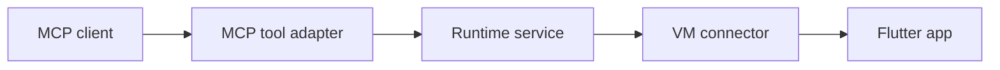

# Server and runtime architecture

The MCP server follows the `mcp_dart` CLI template's separation of server
composition, configuration, and typed tools:

```text
packages/marionette_mcp/
  bin/marionette_mcp.dart       parse options and run the server
  lib/
    marionette_mcp.dart         public server entrypoint
    runtime.dart               public app connection entrypoint
    src/
      mcp/
        mcp.dart               composition root and server instructions
        server_config.dart     standalone MCP server options
        server_context.dart    runtime-to-MCP lifecycle wiring
        server_runner.dart     logging, transports, and shutdown
        step_logging.dart      MCP result logging adapter
        tools/
          base_tool.dart       schema/metadata/execution contract
          tools.dart           complete built-in tool factory
          *_tools.dart         thin MCP adapters by capability
          dynamic_extension_tools.dart  app-specific registration
      vm_service/
        app_connection_service.dart  handshake, sessions, ownership
        vm_service_connector.dart   VM transport and app operations
      session/
        screenshot_service.dart     capture and persistence
        session_manager.dart        report directories and retention
        report_steps.dart           report formatting and persistence
      video/                        recording implementation
```

Only the two `lib/` entrypoints are intended for imports by consumers. All
implementation lives under `src/`, following Dart's package convention. The
`mcp/` directory groups protocol adapters within that internal implementation.

## Responsibility boundaries

| Layer | Owns |
| --- | --- |
| MCP tools | Input/output schemas, request validation, invoking services, mapping results/errors to MCP text/images/structured data |
| Runtime services | Connection workflow, binding compatibility, report-session policy, transition ownership, screenshot storage |
| VM connector | VM transport, app service-extension calls, and app operations |
| Composition root | Constructing dependencies, registering tools, and wiring lifecycle callbacks |
| Server runner | Transport startup and deterministic shutdown |

A tool does not create report directories, decide connection compatibility, or
manage asynchronous connection state. It translates between the MCP contract
and typed runtime inputs/results. Input validation and presentation stay in the
adapter; workflow and persistence stay in services. Simple app-operation tools
can delegate directly to the existing VM connector without an extra service
wrapper for every method.



`AppConnectionService` has no MCP dependency. It owns version checks, session
opt-in/setup, overlapping transitions, and disposal, returning typed outcomes.
The MCP context wires its lifecycle callbacks to dynamic registration and step
logging. This keeps app state authoritative in the service while protocol
callbacks remain adapters. A superseded attempt cannot create a replacement
session or log into it; disconnect retains its original session for its final
report step.

`ScreenshotService` likewise has no MCP dependency. It captures images and
saves numbered files without overwriting prior captures. The tool supplies the
session captured at invocation and maps the typed capture into MCP images or
saved paths.

`createAllTools` builds all 20 built-in tools without opening sockets.
`registerMcpTools` registers them once and applies shared step logging.
Connection tools log their own session transitions because their report owner
changes during execution. App-defined tools have a dedicated dynamic registry,
which retains registration handles and removes them on disconnect/reconnect.

## DRY and KISS

`createAllTools` is the only catalog definition; structured-output tests consume
that same registry. Tools implement their adapter flow directly in `execute`,
without constructor-only group factories or alternate invocation functions.
Shared result envelopes and ancestor descriptions have one definition. Tool
schemas stay explicit where their selectors, descriptions, or recovery messages
differ. Connection ownership types and callbacks remain because they express
real lifecycle rules; simple connector operations do not gain extra service
wrappers just to share a few lines.

## Public package boundaries

Embedders import `package:marionette_mcp/marionette_mcp.dart` for server
composition, owned context, configuration, and startup. Its exports are explicit;
tool implementation classes remain internal. They import
`package:marionette_mcp/runtime.dart` for the app connector.
Existing CLI adapters continue using retained internal compatibility
exports for server startup and shared runtime access; their migration is
separate from the MCP refactor.

MCP tools and executable options keep their names and input schemas.
Runtime implementations cannot import the MCP SDK or MCP adapters. Only two
temporary compatibility exports remain for the CLI's existing imports:
`src/mcp_server_runner.dart` and `src/session/step_logger.dart`. The CLI migration
removes them once it uses the public entrypoints. Runtime implementations do
not depend on these bridges, and new code imports the canonical modules.

## Structured tool results

Every built-in tool advertises an `outputSchema` and returns matching
`structuredContent` on success. The SDK validates these results. Existing
human-readable text and inline images remain available in `content`; error
results retain `isError: true` and need not match a success schema.

| Tool family | Structured success data |
| --- | --- |
| Actions, keyboard, device config, reload/restart | `message`; back navigation may also include `didPop` |
| UI inspection | `elements`, `count` |
| Logs | `logs`, `count` |
| Screenshots | `count`, `inline`, and saved `paths` when applicable; image bytes stay in `content` |
| Extension discovery | `extensions`, `count` |
| Generic and dynamically promoted extensions | `response`, an object containing the app's result |
| Connect | `uri`, `sessionReportsEnabled`, optional `sessionPath` or nonfatal `warning` |
| Disconnect | `disconnected`, optional closing `sessionPath` |

Extension output fields are app-defined, so their response envelope permits
arbitrary properties rather than claiming a schema the app has not supplied.

For embedding, `createMcpServer(context: context)` accepts an explicitly owned
`VmServiceContext`. The caller must await `context.dispose()` and
`server.close()` when its transport ends. The standard `runMcpServer` entrypoint
performs both operations on EOF, signals, and transport startup failure.
Disposing the context retires dynamic tools and closes its app connection.
Disconnecting releases dynamic tool names, so reconnecting uses the current
app's schemas without retaining disabled registrations.

## Bootstrap and shutdown

The executable parses options and delegates to `runMcpServer`. That runner owns
logging, a shared signal owner, the app context, the protocol server, and
the selected transport. Transport startup helpers provide completion and close
operations; they do not each implement their own process lifecycle.

The runner waits for a signal or transport completion, then closes the listener
and active transports, disposes the app runtime, closes the protocol server,
and cancels logging. Cleanup also covers partial startup. Stdio completion
includes immediate stdin EOF; SSE retains its existing endpoints and explicitly
closes active sessions. The SDK owns protocol negotiation, dispatch, validation,
and transport framing; the application owns its process and app resources.

## Adding or changing a tool

1. Put reusable workflow/state/persistence behavior in a runtime service. Keep
   the service API typed and independent of MCP.
2. Implement a `BaseTool` adapter with its input schema, output schema, metadata,
   and result/error formatting. Inject its dependencies through the constructor.
3. Add it once to the central `createAllTools` registry. Keep
   external resource acquisition out of tool constructors and registration.
4. Test service behavior directly, then check the adapter's structured output,
   errors, and public SDK interaction. Update consumer guidance for observable
   changes.

The architecture test enforces the public entrypoints and dependency direction;
it also prevents compatibility bridges from accumulating implementation logic.

## Verification

From the workspace root, resolve dependencies with `flutter pub get`. Run
`dart analyze lib bin test` and `dart test` in both `packages/marionette_mcp`
and `packages/marionette_cli`, then `flutter test --no-pub` in
`packages/marionette_flutter`.

`server_api_test.dart` drives the real executable through public SDK client
APIs to verify catalogs and disconnected errors under legacy initialization
and stateless discovery. Additional in-process public SDK tests use
`IOStreamTransport` to verify successful structured results, dynamic extension
removal, and ordinary error results.
Its catalog fixture
was captured from the original 0.7.0 implementation with SDK 2.4.3; update it
only for an intentional tool-contract change. The comparison permits the new
output schemas while preserving every original input contract and annotation.
Shutdown regressions use a real
Dart VM service fixture and cover connected EOF and signals.

The minimum-toolchain CI job selects separate workspace groups for the
standalone Dart server/CLI and the Flutter binding/adapters. Flutter 3.27's
`flutter_test` pins `meta` to 1.15, while `mcp_dart` 2.4.3 requires 1.16 or
newer. Temporary `pubspec_overrides.yaml` files select workspace members only;
they never override dependency constraints. Dart checks use `--no-example` to
avoid resolving Flutter examples in the server-only workspace. The normal
CI job continues to validate the complete workspace on the pinned Flutter SDK.
The complete workspace and the MCP package's Flutter example combine both
dependency graphs and therefore require a newer Flutter SDK. Flutter 3.27 is
supported for apps using the binding with the server running separately.
