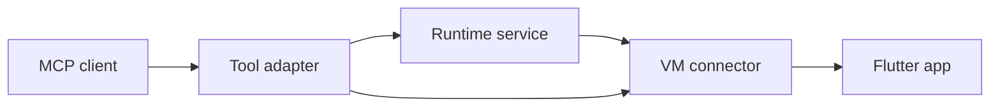

# Server and runtime architecture

Marionette uses typed MCP adapters over independent app runtime services.

```text
lib/
  marionette_mcp.dart           public server API
  runtime.dart                 public app connection API
  src/
    mcp/
      mcp.dart                 composition and registration
      server_config.dart       standalone options
      server_context.dart      runtime-to-MCP wiring
      server_runner.dart       transport and process lifecycle
      step_logging.dart        MCP outcome logging
      tools/                   schemas, execution, and result mapping
    vm_service/
      app_connection_service.dart  handshake, sessions, ownership
      vm_service_connector.dart   VM transport and app operations
    session/
      screenshot_service.dart     capture and storage
      session_manager.dart        report directories and retention
      report_steps.dart           formatting and persistence
    video/                        shared recording implementation
```

Consumers import the two `lib/` entrypoints; implementations live under `src/`.
The public server API exports composition, context, configuration, and startup
explicitly. Tool implementation classes remain internal.

## Responsibilities

| Layer | Owns |
| --- | --- |
| MCP tools | Schemas, request validation, service calls, MCP results/errors |
| Runtime services | Connection workflow, compatibility, report sessions, screenshot storage |
| VM connector | Transport and app service-extension calls |
| Composition/context | Dependency construction, registration, lifecycle callbacks |
| Runner | Startup, signals, transport completion, shutdown |



Runtime code cannot import MCP. `AppConnectionService` owns handshake and session
transitions; `ScreenshotService` owns capture and file numbering. Tools translate
arguments and typed outcomes. Simple app operations can call the connector
directly without an extra service wrapper.

`createAllTools` is the single catalog used by registration and structured-output
tests. Adapters execute directly; shared result envelopes and ancestor descriptions
have one definition. Operation-specific schemas and recovery messages stay local.
The architecture test enforces entrypoints and dependency direction.

Two temporary exports support the unchanged CLI's internal imports:
`src/mcp_server_runner.dart` and `src/session/step_logger.dart`. Its migration to
the public entrypoints removes these bridges; runtime code does not use them.

## Ownership and shutdown

- Constructors and registration acquire no external resources.
- A superseded connection attempt cannot replace the current session or
  registrations. Invocation logging and screenshot capture retain their original
  session; disconnect logs against the closing session.
- Dynamic tools belong to the app connection. Disconnect removes their handles;
  reconnect discovers fresh schemas.
- The runner owns logging, signals, context, server, and transport. It closes
  ingress and active transports, disposes the app, closes MCP, and cancels logging,
  including after partial startup, immediate stdin EOF, or a signal.

Embedders using `createMcpServer(context: context)` must await `context.dispose()`
and `server.close()` when their transport ends. `runMcpServer` handles both.
The SDK owns negotiation, dispatch, validation, and framing.

## Structured results

All built-in tools advertise an `outputSchema` and return matching
`structuredContent` on success. The SDK validates these results. Existing text
and images remain in `content`; `isError: true` results need not match the success
schema. Tool names, input schemas, and annotations remain compatible.

| Tool family | Structured success data |
| --- | --- |
| Actions, keyboard, device config, reload/restart | `message`; back navigation may include `didPop` |
| UI inspection | `elements`, `count` |
| Logs | `logs`, `count` |
| Screenshots | `count`, `inline`, optional saved `paths`; image bytes stay in `content` |
| Extension discovery | `extensions`, `count` |
| Generic/promoted extensions | `response`, allowing app-defined fields |
| Connect | `uri`, `sessionReportsEnabled`, optional `sessionPath` or `warning` |
| Disconnect | `disconnected`, optional closing `sessionPath` |

## Adding a tool

1. Put reusable workflow, state, or persistence in an MCP-independent service.
2. Implement a `BaseTool` with schemas and result/error mapping; inject its
   dependencies through the constructor.
3. Add it once to `createAllTools`.
4. Test service behavior, adapter outputs/errors, and public SDK interaction.
   Update consumer guidance for observable changes.

## Verification

Resolve the workspace with `flutter pub get`. Run `dart analyze lib bin test`
and `dart test` in `packages/marionette_mcp` and `packages/marionette_cli`, then
`flutter test --no-pub` in `packages/marionette_flutter`.

Public SDK tests cover executable catalog/error behavior and in-process structured
results under legacy initialization and stateless discovery. The catalog fixture
comes from the original 0.7.0 server with SDK 2.4.3; change it only for intentional
contract changes. Process tests and real VM fixtures cover connection shutdown,
pending WebSocket upgrades, EOF, signals, SSE, and startup failures.

Minimum-version CI selects separate Dart and Flutter workspace groups:
Flutter 3.27's `flutter_test` pins `meta` 1.15, while `mcp_dart` 2.4.3 requires
1.16+. Temporary `pubspec_overrides.yaml` files select members without changing
dependency constraints; `--no-example` excludes Flutter examples from Dart checks.
Normal CI validates the full workspace on the pinned Flutter SDK. The full
workspace and MCP package's Flutter example require that newer SDK. Flutter 3.27
apps remain supported with the binding and a separately installed server.

## Deferred Streamable HTTP support

In SDK 2.4.3, stateless HTTP creates a server per request, while `connect` retains
app state. Future HTTP support must choose client-state ownership and cleanup
before extending the factory/bootstrap. No HTTP mode is added by this refactor.
